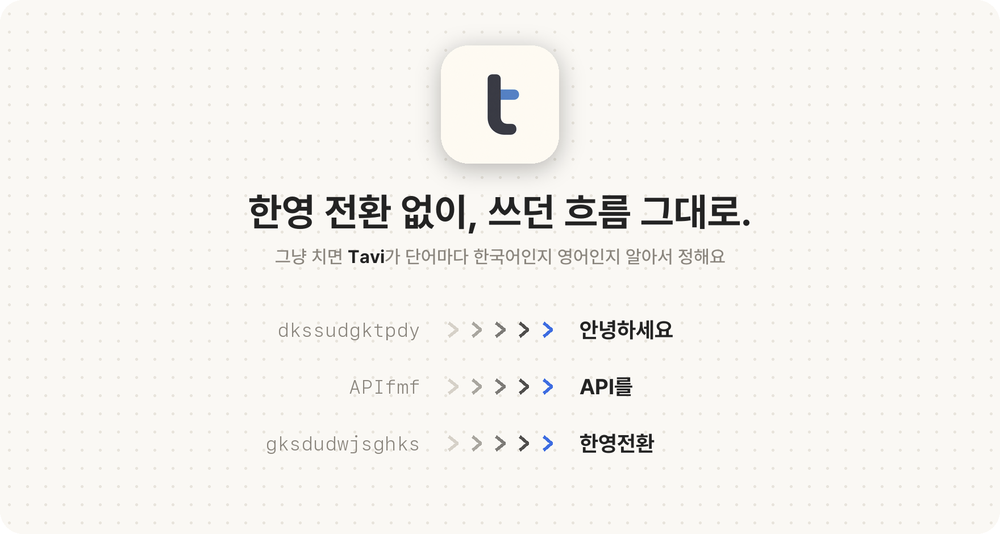

<p align="center">
  <picture>
    <source media="(prefers-color-scheme: dark)" srcset=".github/readme/hero-dark.png">
    
  </picture>
</p>

<p align="center">
  <a href="https://github.com/3x-haust/tavi/releases/latest"><b>Tavi 받기</b></a>
  &nbsp;·&nbsp; macOS 14+ &nbsp;·&nbsp; 기기 안에서만 &nbsp;·&nbsp; 무료 · MIT
</p>

<br>

<p align="center">
  <picture>
    <source media="(prefers-color-scheme: dark)" srcset=".github/readme/install-dark.png">
    
  </picture>
</p>

[최신 릴리스](https://github.com/3x-haust/tavi/releases/latest)에서 `Tavi-<버전>.dmg`를 받아 Tavi를 Applications로 옮긴 뒤 여세요.
앱 안에서 [안내 영상](Resources/setup-guide.mp4)이 나오고, **키보드 설정 열기**를 눌러 Tavi를 추가하면 바로 튜토리얼로 넘어가요.
macOS는 서드파티 입력기를 키보드 설정에서만 추가할 수 있어서, 이 한 번만 직접 누르면 돼요.

> 아직 Apple 공증 전이라 처음 열 때 막히면 **시스템 설정 → 개인정보 보호 및 보안 → 그래도 열기**를 눌러 주세요.

## 쓰는 법

| 키 | 하는 일 |
| --- | --- |
| 그냥 입력 | 단어마다 한국어인지 영어인지 알아서 정해요 |
| **한/영 전환 키** | 입력 중(밑줄)인 단어를 한국어 ⇄ 영어로 바꿔요. 평소 쓰는 키 그대로예요 (Caps Lock, 🌐, ⌃Space…) |
| Space | 단어를 확정하고 띄어 써요 |
| Enter | 단어만 확정해요. 터미널·채팅이 바로 전송되지 않게, 한 번 더 누르면 전송돼요 |
| Esc | 바꾸지 않고 친 그대로 확정해요 |

입력 중인 단어가 없을 때 한/영 전환 키는 원래대로 입력 소스를 바꿔요.

## 쓸수록 내 표기로

같은 표기를 **세 번** 확정하면 그때부터 그렇게 써요. `3Xhaust`처럼 대소문자가 섞인 닉네임도 그대로 기억하고, 많이 쓴 표기일수록 앞서요.
한두 번은 지켜보기만 하고 예측에 반영하지 않아요. 배운 단어는 Tavi 앱의 **내 단어**에서 보고 고치고 지울 수 있어요.

## 내 Mac 안에서만

판단은 기기 안의 작은 통계 모델(약 0.2MB)로만 해요. 입력한 글은 어디로도 보내지 않고, 문장이나 키 입력 기록도 저장하지 않아요.
네트워크는 하루 한 번 이 저장소의 새 릴리스를 확인할 때만 쓰고, 새 버전은 화면 없이 알아서 설치돼요.
Tavi 앱의 **설정 → 업데이트**에서 현재 버전을 보고, 자동 업데이트를 끄거나 **업데이트 확인**으로 바로 받을 수 있어요.
손쉬운 사용·입력 모니터링 권한도 필요 없어요.

## 지우기

Tavi 앱의 **설정 → 입력기 제거…**를 누른 뒤 Applications의 Tavi를 휴지통으로 옮기면 돼요. 개인 사전은 `~/Library/Application Support/Tavi`에 남아요.

## 직접 빌드

Xcode와 Swift 6 이상이 필요해요.

```sh
swift test
bash scripts/build.sh          # dist/Tavi.app
bash scripts/package-dmg.sh    # dist/Tavi-<버전>.dmg
bash scripts/release.sh "변경 내용"   # 두 plist의 버전을 올린 뒤 GitHub 릴리스
```

기여 전에 [CONTRIBUTING.md](CONTRIBUTING.md)를 봐 주세요.

<sub>Tavi는 [MIT License](LICENSE)로 배포돼요. © 2026 3x-haust · 모델 데이터 출처는 [THIRD_PARTY_NOTICES.md](THIRD_PARTY_NOTICES.md)</sub>
